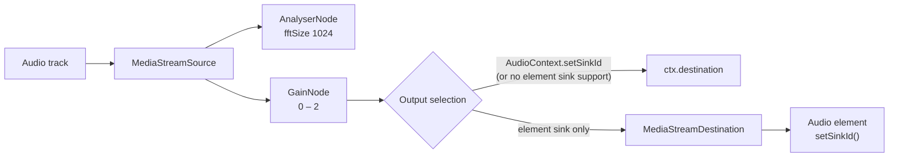

# AVIM

**Real-time audio/video viewer for USB, HDMI and AV capture cards.** A single HTML file with no dependencies, no build step and no server. It runs locally in a Chromium-based browser on top of `getUserMedia` and the Web Audio API.

  

> Download builds and a Windows package on itch.io: https://arsradiophonik.itch.io/

## Screenshots

<p align="center">
  
  
  
</p>

## Contents

- [Screenshots](#screenshots)
- [Overview](#overview)
- [Quick start](#quick-start)
- [Repository layout](#repository-layout)
- [Architecture](#architecture)
- [Video pipeline](#video-pipeline)
- [Audio pipeline](#audio-pipeline)
- [Monitors and diagnostics](#monitors-and-diagnostics)
- [Settings and persistence](#settings-and-persistence)
- [Keyboard shortcuts](#keyboard-shortcuts)
- [Internationalization](#internationalization)
- [Launcher](#launcher)
- [Privacy and security](#privacy-and-security)
- [Known limitations](#known-limitations)
- [Troubleshooting](#troubleshooting)
- [License](#license)

## Overview

Capture cards that follow the UVC/UAC classes show up to the operating system as a webcam plus an audio input. AVIM opens both, renders the video with a plain `<video>` element and routes the audio through a small Web Audio graph, adding the tools you usually want when playing a console through a capture card: scaling modes, aspect control, picture adjustments, level metering, signal diagnostics and a screenshot-to-translator shortcut.

Design constraints:

- **One file.** HTML, CSS, JS and the icon (base64) live in `avim.html`.
- **No network.** No external resources are loaded. The only outbound connection is user-initiated (translate button, author links).
- **No recording, no telemetry.** Frames and samples are only read for display and metering.
- **Low overhead.** Video goes straight from the media stream to the `<video>` element; audio is played through an `AudioContext` created with `latencyHint: 'interactive'`.

## Quick start

**Windows (launcher):**

1. Plug in the capture card and power the source.
2. Double-click `abrir-avim.bat`. AVIM opens as an app window with camera/microphone permission pre-granted.

**Any OS (manual):**

1. Open `avim.html` in a recent Chromium browser (Edge, Chrome, Helium).
2. Allow camera and microphone when asked. Both are required for the signal to arrive.

The UI starts in English; change it from **Settings → Language**.

### Requirements

| Item | Requirement |
|---|---|
| Browser | Recent Chromium-based (Edge, Chrome, Helium). Other engines are untested. |
| Device | Capture card exposed as camera + audio input (UVC/UAC). |
| OS | Windows 10/11 for the launcher; the HTML runs wherever a compatible browser does. |
| Network | Not needed, except for the translate button. |

## Repository layout

```
.
├── avim.html            # The application (HTML + CSS + JS + embedded icon)
├── abrir-avim.bat       # Windows launcher (Helium or Edge in --app mode)
├── avim-icon.png        # 32×32 icon (reference copy; also embedded in avim.html)
├── docs/
│   └── LEEME.es.txt     # Full user/technical manual (Spanish)
└── README.md
```

`avim.html` and `abrir-avim.bat` must stay in the same folder.

## Architecture

There is no framework and no module system. `avim.html` has three parts: a `<style>` block (CSS custom properties, glass-style panels), static markup, and one classic `<script>` that keeps its state in a few top-level variables.

| State | Purpose |
|---|---|
| `P` | Persisted preferences, mirrored to `localStorage` through `save(k, v)`. |
| `W` | Active warnings. Keys such as `ctx`, `audio`, `sink`, `quiet`, `stale`, `black`, `mute`, `toast`. Rendered by `note()` and logged once on appearance. |
| `NL` | In-memory notification log (max 60 entries, not persisted). |
| `stream`, `ac`, `gain`, `an`, `atrack` | Current `MediaStream`, `AudioContext`, gain node, analyser and audio track. |

Warnings and card messages are stored as **message keys**, not rendered text, and translated at draw time. That is what allows switching language while a warning is on screen (see [Internationalization](#internationalization)).

## Video pipeline

**Acquisition.** `getUserMedia` is called with up to three progressively looser constraint sets. Each attempt that fails with a non-fatal error moves to the next:

1. Video with `width/height/frameRate` as `ideal`, plus audio with the selected device and processing disabled.
2. Video and audio without mode constraints.
3. Video only.

`NotAllowedError` and `NotReadableError` are treated as hard failures: if the failed attempt included audio, the cascade jumps straight to the video-only attempt (so a blocked or busy audio device does not prevent video); if it was already video-only, it stops and shows the error. Resolution **Auto** requests 1920×1080 as the ideal; otherwise the selected mode. Frame rate is 60 or 30 as ideal. All of these are preferences: the device delivers its nearest supported mode, and PAL/NTSC sources typically deliver 25 / 29.97 fps regardless.

**Device selection.** Saved device IDs are matched first by `deviceId` and then by label. With no saved choice, video prefers a label matching `captur|grabber|hdmi|av|cam link|elgato|avermedia|easycap|usb video`; audio prefers the input in the same `groupId` as the chosen video device, then a label heuristic that also includes `digital audio` and `macrosilicon`. After opening, `settle()` re-enumerates devices and reopens once or twice if the browser handed back a different device than the one selected.

**Rendering.**

- Fit-to-window size is computed in `layout()` from the frame size and the selected aspect, multiplied by the image scale (25–200 %).
- **Auto aspect:** 4:3 when the frame width is 720 or 704 and height ≤ 576; otherwise the native ratio. **Fill** stretches to the window.
- **Scaling:** *Smooth* = browser interpolation, *Sharp* = `image-rendering: pixelated`, *Pixel-perfect* = pixelated with integer factors when enlarging.
- **Picture adjustments** are a CSS `filter` (`brightness() contrast() saturate()`) on the `<video>` element: brightness 50–150 %, contrast 50–150 %, color 0–200 %.
- **Frame counting** uses `requestVideoFrameCallback` when available and falls back to `timeupdate`. FPS is sampled once per second.

**Recovery.** `devicechange` re-enumerates devices and reopens automatically if the video input was lost and reappears. On `visibilitychange`, `fullscreenchange` and window `focus`, `revive()` re-lays out, resumes playback, and, if no frame arrived within 1.5 s, re-attaches `srcObject`.

## Audio pipeline

Audio is requested with `echoCancellation`, `noiseSuppression` and `autoGainControl` all **off** and `channelCount: ideal 2`, to keep the source signal untouched. The `AudioContext` uses `latencyHint: 'interactive'` and the track's own sample rate when the browser allows it (falling back to the default rate otherwise).



- **Volume** is the gain value, 0–2 (0–200 %). Default 30 %. Mute sets gain to 0.
- **Output device:** when `AudioContext.setSinkId` exists the context sends to the chosen sink. Otherwise, if only `HTMLMediaElement.setSinkId` exists, the gain output goes through a `MediaStreamDestination` into an `Audio` element whose sink is set. The selector is hidden if neither API exists.
- **Metering point:** the analyser taps the source **before** the gain stage, so the meter shows the input level regardless of volume or mute.
- **Autoplay policy:** if the context is not `running`, a warning asks for a click; any pointer or key event then calls `resume()`.

## Monitors and diagnostics

Three lights (video, audio, notifications) toggle floating monitor windows. A monitor with **Active monitor** on stays visible even when the UI auto-hides after 1.2 s of inactivity, and is restored on startup. Defaults: video on, audio off.

### Level meter

- Reads `getFloatTimeDomainData` on a 1024-sample window every animation frame and takes the max absolute value, expressed in dBFS.
- 16 segments across −50 … −1 dBFS (about 3.06 dB each).
- **Attack:** instantaneous. **Release:** 70 dB/s.
- **Peak marker:** one extra segment, held 600 ms, then falling at 30 dB/s.
- The yellow lamp brightness follows the same level.

### Video monitor

Shows frame resolution and presented FPS (updated once per second). Status text: *Connecting*, *No image* (no frame for more than 3 s) or *No connection*.

### Error checking (optional)

Always-on warnings: permission denied, device not found or busy, unsupported constraints, video or audio input lost, audio start failure, invalid audio output, suspended audio context, and no audio input selected.

With **Error checking** enabled, these are added:

| Check | Condition |
|---|---|
| No frames | No frame for more than 3 s |
| Black image | Mean luminance < 4/255 on a 16×12 downscaled sample for 5 consecutive seconds |
| Muted video track | The track fires `mute` (device stopped sending) |
| No sound | Peak < 0.004 (≈ −48 dBFS) for 6 consecutive seconds, while the context is running and the tab is visible |

Each message is logged once when it appears and not repeated while it stays active. The red lamp blinks while any warning is active.

## Settings and persistence

Everything is stored in `localStorage` with the `av.` prefix, scoped to the browser profile in use.

| Key | Content |
|---|---|
| `vid`, `vl` | Video device ID and label |
| `ain`, `al` | Audio input ID and label |
| `aout`, `ol` | Audio output ID and label |
| `res`, `fps` | Requested resolution and frame rate |
| `asp`, `scl` | Aspect mode and scaling mode |
| `pos` | Control bar position (`bc`, `bl`, `br`, `tl`, `tr`, `off`) |
| `vol`, `volv`, `mute` | Volume, volume-default migration flag, mute |
| `br`, `co`, `sa` | Brightness, contrast, color (percent) |
| `zoom` | Image scale (percent) |
| `chk` | Error checking on/off |
| `mv`, `ma` | Video / audio monitor pinned |
| `keys` | Shortcut overrides |
| `lang` | Interface language (`en`, `es`, `ja`, `zh`) |

Resetting means clearing site data for the page or deleting the launcher profile folder (see below).

## Keyboard shortcuts

Reassignable under **Settings → Keyboard shortcuts**. Assigning a key already in use swaps the two actions. Shortcuts are ignored with Ctrl/Alt/Meta held and while a dropdown has focus.

| Action | Default |
|---|---|
| Settings | `A` |
| Mute | `M` |
| Screenshot (PNG) | `C` |
| Translate screenshot | `T` |
| Image scale | `Z` |
| Floating window (PiP) | `P` |
| Fullscreen | `F` (also double-click on the image) |
| Close | `Esc` — closes in order: shortcuts dialog, scale control, settings, monitors |

With the control bar hidden, the scale shortcut opens Settings, where the same control lives.

### Screenshot and translate

- **Screenshot** renders the current frame at native resolution to a canvas with the active brightness/contrast/color filter, and downloads `capture-<UTC timestamp>.png`.
- **Translate** draws the frame without filters, upscaled by an integer factor `k = clamp(floor(2160 / width), 1, 4)` with smoothing disabled, copies it to the clipboard as `image/png`, then opens Google Translate in image mode in a popup:
  `https://translate.google.com/?sl=ja&tl=<ui-language>&op=images`.
  Source is fixed to Japanese. Target follows the UI language (`en`, `es`, `zh-CN`; Japanese UI maps to `en`). Paste with Ctrl+V. This is the only feature that needs internet.

## Internationalization

Languages: English (default), Español, 日本語, 中文（简体）.

All strings live in one dictionary, `const I = { en: {…}, es: {…}, ja: {…}, zh: {…} }`. Static markup uses attributes that `applyLang()` resolves on language change:

| Attribute | Effect |
|---|---|
| `data-i="key"` | Sets `textContent` |
| `data-ti="key"` | Sets `title` |
| `data-ar="key"` | Sets `aria-label` |

Dynamic messages (warnings, errors, card text, monitor status) are stored as keys; parameters are appended with `\u0001`, and compound card + message entries with `\u0002`. `tr()` expands them using `{0}` placeholders. Lookup falls back to English, then to the key itself.

**Adding a language:**

1. Copy the `en` block in `I`, translate every value, and add it under a new code (for example `fr`).
2. Add the code to `HL` (the `<html lang>` value), `LOC` (locale for log timestamps) and `TL` (Google Translate target).
3. Add an `<option value="fr">Français</option>` to `#sl`.
4. If the script needs specific fonts, add an `html:lang(fr) body{font-family:…}` rule (as done for `ja` and `zh`).

## Launcher

`abrir-avim.bat` starts a Chromium browser in app mode:

| Flag | Purpose |
|---|---|
| `--app=<path>` | Opens `avim.html` as an app window without tabs or address bar |
| `--use-fake-ui-for-media-stream` | Auto-accepts the camera/microphone prompt |
| `--test-type` | Suppresses the “unsupported command-line flag” infobar caused by the flag above |
| `--user-data-dir=<dir>` | Isolated profile where AVIM keeps its settings |

Browser selection: Helium at `%LOCALAPPDATA%\imput\Helium\Application\chrome.exe` if present (profile `%LOCALAPPDATA%\VisorAV-Helium`), otherwise Edge (`msedge`, profile `%LOCALAPPDATA%\VisorAV`). To use Chrome, replace `msedge` with `chrome` in the last line.

## Privacy and security

- Video and audio are processed locally; nothing is recorded or transmitted.
- No telemetry, no analytics, no external resources.
- Settings live only in the local browser profile.
- `--use-fake-ui-for-media-stream` grants camera and microphone **without prompting**. Use it only with the dedicated profile created by the launcher, and browse the web with a different browser or profile.
- AVIM does not circumvent content protection (HDCP, etc.) applied by the source or capture device.

## Known limitations

- Total latency depends on the capture device, its driver, the browser and the display; AVIM adds no processing to the video path beyond the CSS filter.
- Output device selection and Picture-in-Picture depend on browser support.
- The launcher is Windows-only.
- Non-Chromium browsers are unverified.
- The notification log is in memory only (60 entries).

## Troubleshooting

| Symptom | What to check |
|---|---|
| No image | Cable and source power; **Reconnect**; close other apps holding the device (OBS, other tabs). Only one app can open it. |
| Permission denied | Re-allow from the lock icon (manual mode), or delete the launcher profile folder. |
| No sound | Open the audio monitor. If the meter moves, the signal arrives: check volume and mute. If not, choose the right audio input. |
| Audio context warning | Click anywhere on the page (autoplay policy). |
| Wrong aspect | Set **Aspect ratio** to 4:3 for classic sources or 16:9 for modern ones. |
| Red lamp blinking | An active warning exists: open the notifications monitor. |

## License

Free to use: you may use, copy, share and modify AVIM at no cost.

## Author

Ars Radiophonik, 2026 · [itch.io](https://arsradiophonik.itch.io/) · [GitHub](https://github.com/arsradiophonik)
